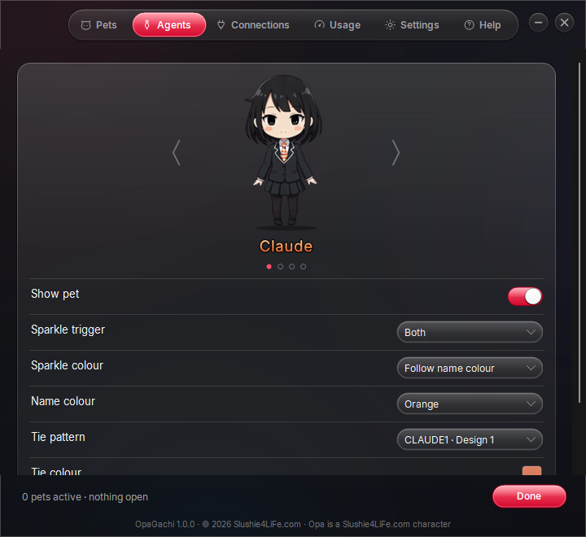

# OpaGachi

Little animated desk pets that sit above your Windows taskbar and act out what your AI agents are doing:
thinking, working, waiting for your approval, failed, or done.

Works with the **Claude, ChatGPT, Gemini and Grok** desktop apps and with **Claude Code, Codex, Gemini CLI and
Grok Build**. Each open agent gets its own pet with its own tie and name colour.

## Download

Get `OpaGachi-<version>.zip` from [Releases](../../releases/latest), unzip it and run `OpaGachi Setup.exe`.
It installs for your Windows account only (no admin rights) and adds OpaGachi to the Start menu. Run a newer
Setup to update; your settings are kept. Uninstall from Windows Settings > Apps.

Needs Windows 10 or 11. Nothing else to install.

> **Not code-signed yet.** Windows SmartScreen warns before the first run ("More info" > "Run anyway"), and PCs
> with Smart App Control turned on block the installer. Signing is planned.

## Privacy

- Everything runs on your PC: no account, no analytics, no ads, no servers, nothing sent over the internet.
- OpaGachi listens only on `127.0.0.1` (this PC) for its optional agent hooks, and refuses requests from web pages.
- Hooks are added only when you choose them on the Connections page, and the uninstaller removes them.
- Settings and anything you add live in `%LOCALAPPDATA%\OpaGachi`.

## Build it yourself

Needs only Windows with the .NET Framework 4.8 that ships with it: no SDK, no installer toolkit. The code is
C# 5 so Windows' built-in compiler can build it.

| Command | What it does |
|---|---|
| `build.cmd` | Builds `bin\OpaGachi.exe` |
| `run.cmd` | Builds if needed, then starts it (`run.cmd --demo` plays every animation) |
| `package.cmd` | Builds `dist\OpaGachi Setup.exe` and the download `dist\OpaGachi-<version>.zip` |

Tests (PowerShell): `tools\dev\review_capture.ps1`, then, after `package.cmd`, `tools\dev\setup_test.ps1` and
`tools\dev\wizard_test.ps1`. They point `OPAGACHI_HOME` at a temporary folder, so they never touch your real
agent settings or OpaGachi data. `setup_test.ps1` briefly creates and removes a Start menu entry and an Apps entry.

Every push builds on GitHub Actions. Publishing a release (tag `vX.Y.Z`, matching the version in
`src\AssemblyInfo.cs`) attaches the zip to it automatically.

The full technical reference (detection, settings keys, file map, flags, release steps) is
[docs/TECHNICAL.md](docs/TECHNICAL.md). What changed in each version: [CHANGELOG.md](CHANGELOG.md).

## Security

Please report vulnerabilities privately; see [SECURITY.md](SECURITY.md).

## License

- **Code:** OpaGachi is free software: you can redistribute it and/or modify it under the terms of the GNU
  General Public License as published by the Free Software Foundation, either version 3 of the License, or (at
  your option) any later version (GPL-3.0-or-later). It comes with no warranty. See [LICENSE](LICENSE).
  Copyright © 2026 Slushie4LiFe.
- **The Opa character and the app's artwork** (sprites, tie designs, icon): © Slushie4LiFe, not covered by the GPL; see
  [ASSETS-LICENSE.md](ASSETS-LICENSE.md).
- **Third-party:** the Inter typeface and Pixabay sound effects; see [THIRD-PARTY-NOTICES.md](THIRD-PARTY-NOTICES.md).

Created by Slushie4LiFe. Special thanks to Quil (Quest) and BigRedSoda (Jdyn).
Opa is a Slushie4LiFe.com character. More at Slushie4LiFe.com.
